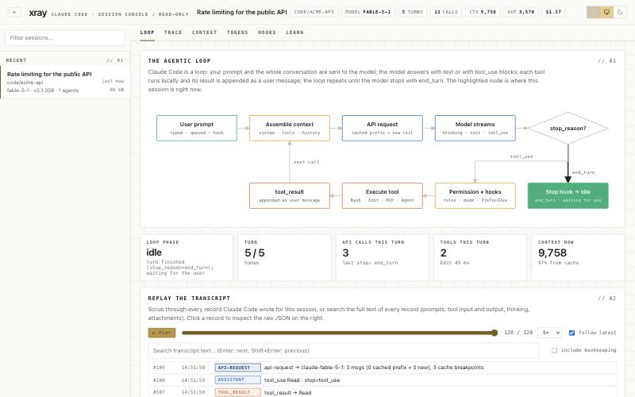
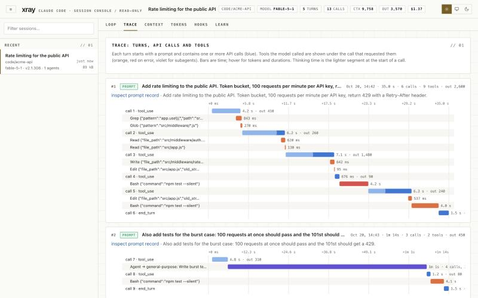
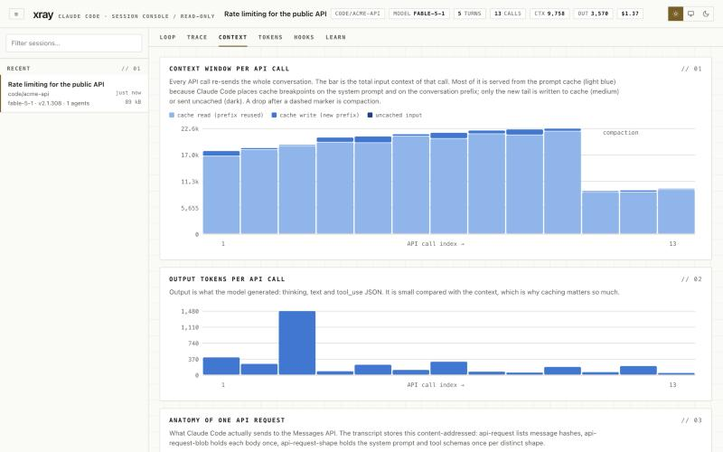
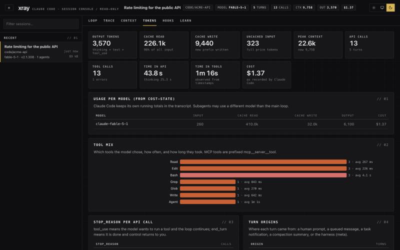
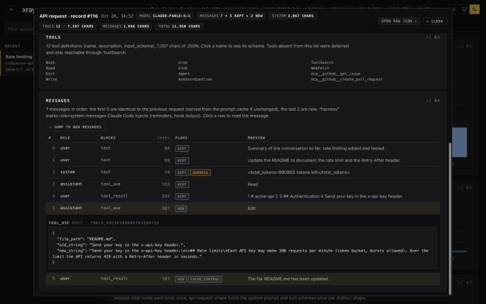

# Claude Code X-Ray

**See what Claude Code is doing inside any session on your machine, live or finished.**
The agentic loop, every API call, every tool call, subagents, the context window
and prompt cache, compaction, hooks and cost, with the raw transcript record one
click away.

  

Built as a learning tool for people who use Claude Code and want to understand
the machine underneath it. Read-only, local-only, zero install.



| Trace: calls, tools, subagents | Context window and cache | Tokens (dark) | Reconstructed API request |
| --- | --- | --- | --- |
|  |  |  |  |

Screenshots show the built-in synthetic demo session.

## Quick start

```bash
git clone https://github.com/madannikalje/claude-code-xray.git
cd claude-code-xray
node server.mjs
```

Open http://127.0.0.1:4545. That is all: no `npm install`, no build step.
Running sessions appear at the top of the sidebar with a green (idle) or pulsing
ochre (busy) dot. Pick any session, live or old.

No Claude Code sessions on this machine yet? Try the synthetic demo session:

```bash
node server.mjs --demo
```

Then follow [docs/guide.md](docs/guide.md), a 15-minute walkthrough that
traces one turn through the loop, the transcript, the context window and the
exact API request.

Optional, for real-time lifecycle events (prompt submitted, before and after each
tool, permission requests, subagent start and stop, compaction, stop):

```bash
node server.mjs --install-hooks
```

This adds HTTP hooks to `~/.claude/settings.json` (a timestamped backup is
written first; existing hooks are kept). Claude Code picks the change up
without a restart in recent versions. Remove with `--uninstall-hooks`.

## What it shows

| Tab | What you see | The mechanism it explains |
| --- | --- | --- |
| **Loop** | A state machine with the current phase highlighted, plus a replay scrubber over every transcript record (space to play, arrows to step) | Claude Code is a while-loop: assemble context, call the API, run tools until `stop_reason` is `end_turn` |
| **Trace** | Per-turn waterfalls: API calls (blue), tools (orange), subagents (violet), errors (red), thinking as a light segment | One API response is many content blocks; `tool_use` and `tool_result` are paired by id; where time goes |
| **Context** | Stacked context per call (cache read, cache write, uncached), compaction markers, the anatomy of one real request with a button that rebuilds the exact API body sent (system, tools, all messages, cache breakpoints), the attachments the harness injects | Prompt caching, context growth, compaction, what gets sent that you never typed |
| **Tokens** | Totals, cost as Claude Code recorded it, per-model usage, tool mix, stop reasons, subagents | Where the tokens and the money go |
| **Hooks** | Live hook feed, hook outcomes recorded in the transcript, event reference, one-click install | The extension points of the loop |
| **Learn** | Twelve short lessons linked to the tabs, and every record type in the open transcript with its meaning | The vocabulary |

The Loop tab also has a full-text search over every record of the transcript
(prompts, tool input and output, thinking, attachments): type, press Enter to
step through matches, and the loop panel follows the cursor. Bookkeeping
records and cache blobs are skipped unless you tick "include bookkeeping".

Click any bar, row or record to open the **Inspector**: the raw JSON record read
straight from disk, with annotations for the fields that matter (`parentUuid`,
`requestId`, `usage`, `stop_reason`, `permissionDecision`, cache breakpoints).
Click a subagent to open its own transcript in the same views.

## Features

- **Zero dependencies.** One Node process, built-in `http` and `fs`, vanilla JS
  in the browser, hand-drawn SVG charts. The whole thing is about 2,500 lines
  you can read in an afternoon.
- **Live.** Transcripts are tailed by byte offset and pushed to the browser over
  Server-Sent Events; hook events arrive the moment Claude Code fires them.
- **Scales to real history.** Parsed server-side into a compact model; a 10 MB
  session loads in well under a second, a 200 MB session with hundreds of
  subagents in a few seconds.
- **Explains as it shows.** Every panel carries a short explanation of the
  mechanism behind the numbers, and every record type and field is documented
  in the Inspector.
- **Light, dark and system themes.**

## Where the data comes from

Claude Code keeps its state in plain files under `~/.claude`. None of this is
documented by Anthropic; it is what version 2.1.30x writes on macOS and is
described in detail in [docs/design.md](docs/design.md).

| Source | Contents |
| --- | --- |
| `~/.claude/projects/<cwd-slug>/<sessionId>.jsonl` | The transcript, one JSON record per line: `user` and `assistant` messages, `attachment` records the harness injects, `api-request` / `api-request-blob` / `api-request-shape` (the real API call, content-addressed), `cost-state`, `queue-operation`, file checkpoints, permission mode, titles |
| `~/.claude/projects/<slug>/<sessionId>/subagents/agent-<id>.jsonl` + `.meta.json` | Subagent transcripts (`isSidechain: true`) with agent type, description and the parent `tool_use` id |
| `~/.claude/sessions/<pid>.json` | Running sessions: pid, status, cwd. X-Ray checks the pid to decide what is live |
| HTTP hooks (`POST /hook`) | The same JSON that command hooks receive on stdin |

## How it works

```
server.mjs         HTTP + SSE on 127.0.0.1, static files, JSON API, /hook receiver
lib/discovery.mjs  find projects, sessions, subagents, live processes, tasks
lib/parser.mjs     JSONL records -> session model (turns, calls, tools, attachments, ...)
lib/slim.mjs       truncate heavy payloads before parsing
lib/tail.mjs       byte-offset tailing (750 ms poll) for live sessions
lib/hooks.mjs      normalise hook POSTs, settings.json install and uninstall
public/            single page app: app.js (shell), views.js (tabs), charts.js, util.js
test/              node:test suite for the parser
demo/              generator for the synthetic demo session (--demo)
docs/              design notes, guide, screenshots
```

The server parses each transcript once into a model and remembers the byte
offset of every line, so the Inspector can read any raw record from disk on
demand. The browser receives the model (a few MB for a large session), then
incremental deltas as new lines are appended. Very large sessions send subagent
summaries and load each subagent when you open it.

## API

Everything the UI uses is plain JSON, so you can build your own views on top.

| Endpoint | Returns |
| --- | --- |
| `GET /api/sessions` | All sessions with metadata, plus live processes |
| `GET /api/session/:id` | The parsed model (`snapshot`) |
| `GET /api/session/:id/record/:n[?agent=<id>]` | Raw record `n` |
| `GET /api/session/:id/shape/:hash` | System prompt blocks and tool schemas of a request shape |
| `GET /api/session/:id/agent/:agentId` | A subagent's full model |
| `GET /api/session/:id/search?q=text[&agent=<id>&all=1]` | Full-text search: record indices with snippets |
| `GET /api/session/:id/request/:n[?raw=1]` | The full Messages API body rebuilt for api-request record `n` (`raw=1` keeps image data) |
| `GET /api/events?session=:id` | SSE stream: `sessions`, `delta`, `agent`, `hook` |
| `GET /api/hooks?session=:id` | Hook events received for a session |
| `GET /api/hook-config` | The settings.json snippet and install status |
| `POST /hook` | Receiver for Claude Code HTTP hooks |

## Configuration

| Option | Default | Notes |
| --- | --- | --- |
| `--port` | `4545` | Also `PORT` env var |
| `--host` | `127.0.0.1` | Keep it local; there is no authentication |
| `CLAUDE_CONFIG_DIR` | `~/.claude` | Where Claude Code keeps its data |
| `--install-hooks` / `--uninstall-hooks` | | Edit `~/.claude/settings.json` with a backup |
| `--demo` | | Serve a generated synthetic session from `demo/claude-home` instead of `~/.claude` |

## Troubleshooting

- **"No sessions found."** X-Ray reads `~/.claude/projects`. If Claude Code
  stores data elsewhere, set `CLAUDE_CONFIG_DIR`.
- **Port already in use.** Run with `--port 4546` and reinstall the hooks so the
  URL matches.
- **Hook feed stays empty.** Check the Hooks tab says "installed"; sessions
  started before the install may need a restart. If X-Ray is not running,
  Claude Code treats the refused connection as a non-blocking error and
  continues, so hooks never block your work.
- **Cost shows n/a.** Cost is only displayed when Claude Code wrote a
  `cost-state` record. X-Ray does not estimate prices.
- **Old sessions have no "Anatomy of one API request".** The `api-request`
  records only exist in transcripts written by Claude Code 2.1.29x and later.
- **A huge session is slow.** A 200 MB transcript with hundreds of subagents
  takes a few seconds and around a gigabyte of memory to parse. The server
  keeps at most four sessions in memory and evicts the least recently used.

## Development

```bash
node --test test/parser.test.mjs   # parser tests
node server.mjs                    # then edit public/ and reload, no build step
```

Transcript fields are reverse-engineered from the current Claude Code version.
The parser ignores record types and fields it does not know, so a new version
degrades gracefully; adding support usually means a new `case` in
`lib/parser.mjs` and a line in `RECORD_KINDS`.

## Privacy and safety

- Binds to `127.0.0.1` only and never uploads anything.
- Read-only on transcripts. The only file it ever writes is
  `~/.claude/settings.json`, and only when you run `--install-hooks` or
  `--uninstall-hooks`, with a backup first.
- Transcripts contain your prompts, file contents and tool output. Keep the
  port local and do not expose it on a shared machine.

## Design

The UI uses an editorial console look: paper surfaces with a faint grid,
hairline borders, square corners, uppercase tracked micro-labels in monospace,
numbered sections, and one ochre "signal" accent. Data marks use a
separately validated categorical palette so series stay distinguishable for
colour-blind readers; the brand accent is reserved for chrome.

## Prior art

Tools that cover parts of this: [claude-session-visualizer](https://github.com/anaypaul/claude-session-visualizer)
(React, JSONL + SSE), [agents-observe](https://github.com/simple10/agents-observe)
(hook-driven, Docker + SQLite), [claude-code-trace](https://github.com/delexw/claude-code-trace)
(Rust log viewer), [claude-session-dashboard](https://github.com/dlupiak/claude-session-dashboard),
[claude-view](https://github.com/tombelieber/claude-view), [session-observer](https://github.com/Ax-For/session-observer).
X-Ray differs in being dependency-free, in explaining the mechanism alongside
the data (API request anatomy, cache breakpoints, attachments, record types),
and in combining transcript tailing with HTTP hooks in one page.

## License

MIT. See [LICENSE](LICENSE).
